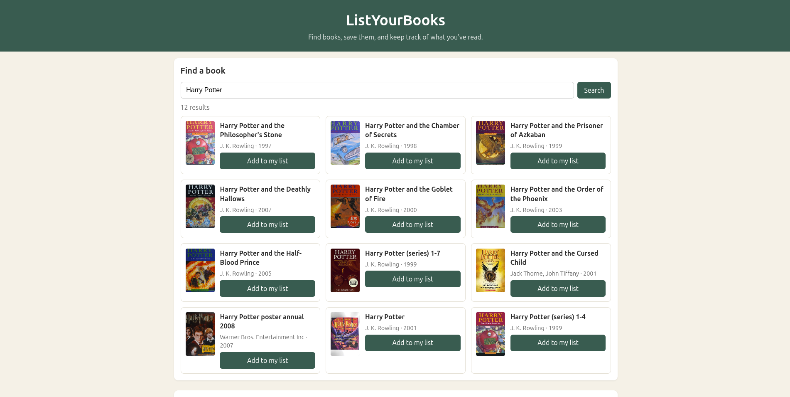

# ListYourBooks

A small web app to keep track of the books you read. You can search for a book,
save it to your list, set it to *Want to read*, *Reading* or *Finished*, and give
finished books a rating and a note.

Book data comes from the free [Open Library API](https://openlibrary.org/developers/api) (no API key needed).

Made by Marcos Eduardo da Costa (Student ID 102302974, Computer Science, IU)
for the course *Project: Java and Web Development (CSEBCSPJWD01)*.



## How to run it

You need [Node.js](https://nodejs.org) version 20 or newer.

```
git clone https://github.com/MarcosCosta0209/ListYourBooks.git
cd ListYourBooks
npm start
```

Then open http://localhost:3000 in your browser.

There is nothing else to install. The search needs internet, and your list is saved in `data/books.json`.

To run the tests:

```
npm test
```

## Technologies

- **Frontend:** HTML, CSS and JavaScript
- **Backend:** Node.js (built-in `http` module)
- **Storage:** a JSON file
- **Tests:** Node's built-in test runner

At first I planned to use Express and SQLite. I didn't need them, because the app
only has a few routes and one user, so I left them out to keep the project simple.

## Files

- `server.js` – the backend and its routes
- `src/books.js` – saving and checking the books
- `src/openLibrary.js` – the search on Open Library
- `public/` – the website (HTML, CSS, JavaScript)
- `tests/` – the tests
