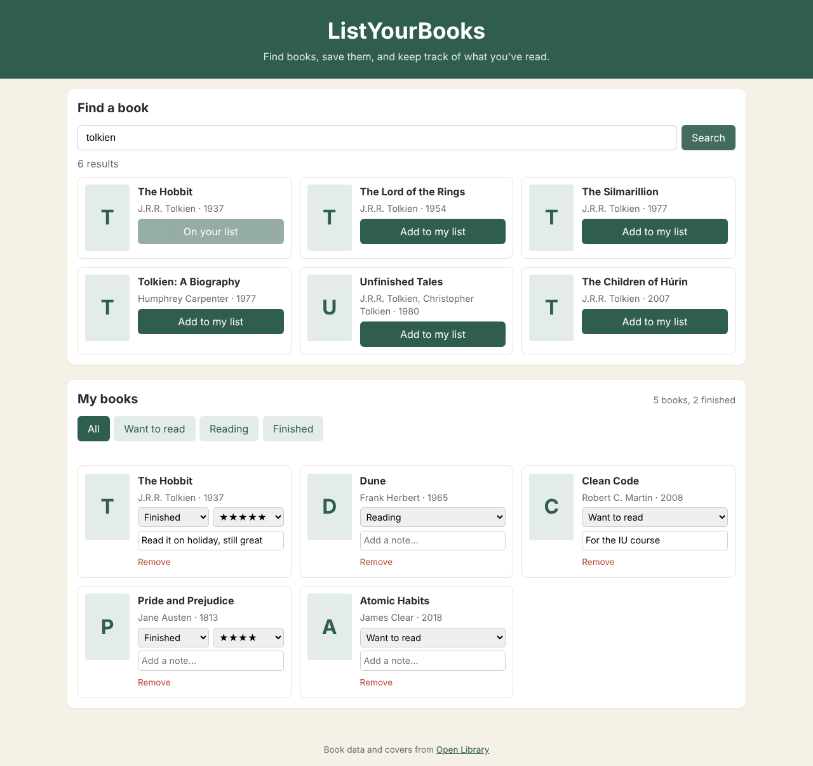
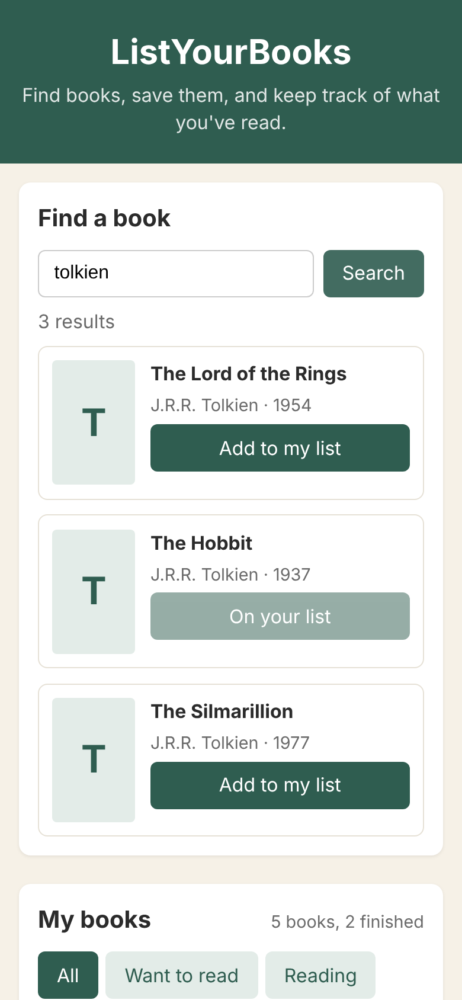
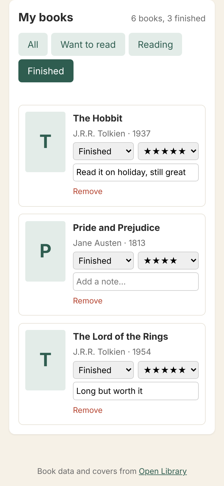

# ListYourBooks

A small web app to keep track of books: search for a book, save it to your list,
mark it as *Want to read*, *Reading* or *Finished*, rate it and add a short note.

Book data and covers come from the free [Open Library API](https://openlibrary.org/developers/api).
No API key or account is needed.

| | |
|---|---|
| Author | Marcos Eduardo da Costa |
| Student ID | 102302974 |
| Study program | Computer Science (IU International University of Applied Sciences) |
| Course | Project: Java and Web Development (CSEBCSPJWD01) |
| Repository | https://github.com/MarcosCosta0209/ListYourBooks |

## Features

- Search books by title or author (Open Library, called by the backend)
- Add a book to your list with one click
- Change the status: Want to read / Reading / Finished
- Rate finished books (1 to 5 stars) and write a note
- Filter the list by status, remove books
- Responsive layout (1 column on phones, 2 on tablets, 3 on desktop)

## Screenshots

Desktop view (search results and saved list):



Phone view (search and list filtered by "Finished"):

 

## Technologies

| Part | Technology | Why |
|---|---|---|
| Frontend | HTML, CSS, plain JavaScript (fetch) | Small app, no framework needed |
| Backend | Node.js with the built-in `http` module | Only 5 routes, no extra dependencies |
| Storage | JSON file (`data/books.json`) | One user, small data, nothing to install |
| External API | Open Library Search API | Free, no key, large book catalogue |
| Tests | Node's built-in test runner (`node:test`) | Works out of the box |

In the concept phase I planned Express and SQLite. During development I switched to
the built-in `http` module and a JSON file, because the app only has five routes and
one user. That way the project has **no npm dependencies**, and nothing has to be installed apart from Node.js.

## Installation and running

1. Install **Node.js 20 or newer** (the LTS version from https://nodejs.org is fine).
   Check it with:
   ```
   node -v
   ```
2. Download or clone this repository:
   ```
   git clone https://github.com/MarcosCosta0209/ListYourBooks.git
   cd ListYourBooks
   ```
3. Start the server:
   ```
   npm start
   ```
4. Open **http://localhost:3000** in your browser.

The search needs an internet connection (it asks Open Library). Your saved list is
stored in `data/books.json`, which is created automatically when you add the first book.

To use another port: `PORT=8080 npm start` (on Windows PowerShell: `$env:PORT=8080; npm start`).

## Running the tests

```
npm test
```

There are unit tests for the data and validation logic (`tests/books.test.js`) and
integration tests that start the server and send real HTTP requests (`tests/api.test.js`).
The tests use a temporary data file, so your own list is not changed.

## API

| Method | Route | What it does |
|---|---|---|
| GET | `/api/search?q=hobbit` | Searches Open Library and returns a simplified list |
| GET | `/api/books` | Returns all saved books |
| GET | `/api/books?status=Finished` | Returns only books with that status |
| POST | `/api/books` | Adds a book (`title` is required) |
| PUT | `/api/books/:id` | Changes `status`, `rating` (1-5 or null) or `note` |
| DELETE | `/api/books/:id` | Removes a book |

Errors come back as JSON, for example `{ "error": "Title is required" }`, with status 400, 404, 409 or 502.

## Project structure

```
ListYourBooks/
  server.js            backend: routes + serving the frontend files
  src/
    books.js           saving, loading and validating books
    openLibrary.js     calls the Open Library API and simplifies the answer
  public/
    index.html         the page
    style.css          styles (mobile first)
    app.js             frontend logic (fetch calls, rendering, events)
  tests/
    books.test.js      unit tests
    api.test.js        integration tests
  data/                books.json is created here
```

## Note for Open Library

Open Library asks apps to send a `User-Agent` that says who they are and how to
contact them. The app sends `ListYourBooks/1.0` with the link to this repository
(see `src/openLibrary.js`).
